

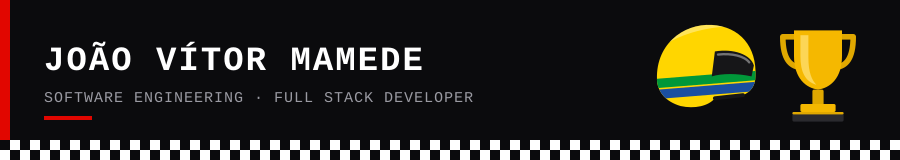

[🇧🇷 Português](README.md) · 🇬🇧 English

## 🏁 Driver Profile - About me

8th-term Software Engineering student at **Faculdade SENAI Fatesg** (since 2023), focused on web applications, project leadership and full stack development. I completed an international internship at **ZEISS** headquarters in Oberkochen, Germany, and I work at the intersection of metrology, digital transformation and technological innovation.

- 🎓 Software Engineering, Faculdade SENAI Fatesg
- 🌍 International internship at ZEISS IQS, Germany
- 🗣️ Portuguese · English (fluent, ECCE certified) · German (intermediate)
- 📜 AWS Academy Cloud Foundations · Metrology course (INMETRO)
- 📍 Goiânia, Brazil

## 🛞 Stints - Experience

  

## ⚙️ Power Unit - Stack

  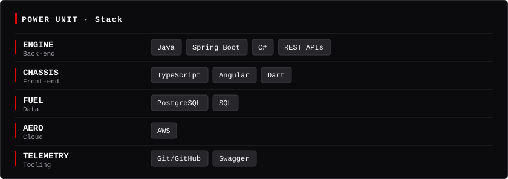

## 🏆 Podium - Featured projects

<table align="center">
  <tr valign="bottom">
    <td><a href="https://github.com/fraissatt/CEM-Senai-Zeiss">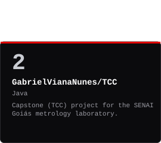</a></td>
    <td><a href="https://github.com/fraissatt/metas-app">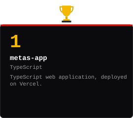</a></td>
    <td><a href="https://github.com/fraissatt/boas-praticas-software">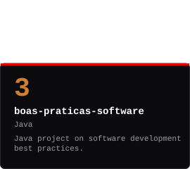</a></td>
  </tr>
</table>

▶ <a href="https://metas-app-flax.vercel.app">metas-app: view demo</a>

## 🏎️ Pit Lane - Garage

  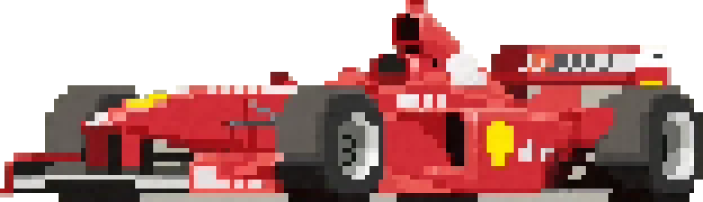
  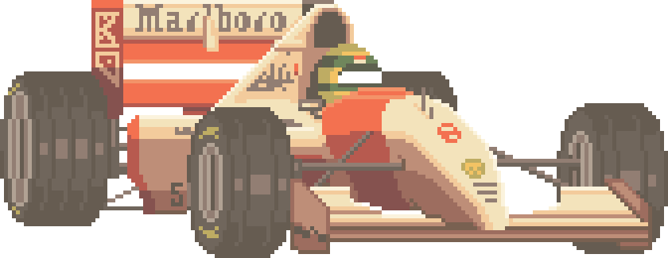

🔴 Ferrari · Schumacher era &nbsp;·&nbsp; ⚪🔴 McLaren · Senna (1990–1993)

  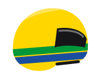
  &nbsp;&nbsp;
  

Yellow, green and blue helmet, inspired by Senna's · 🏆 Monaco: six wins for Ayrton Senna, the Grand Prix record

<table align="center">
  <tr>
    <td align="center">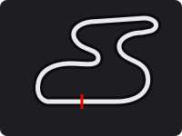 🇧🇷 Interlagos</td>
    <td align="center">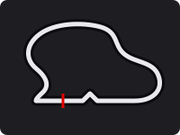 🇮🇹 Monza</td>
    <td align="center">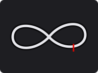 🇯🇵 Suzuka</td>
    <td align="center">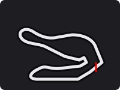 🇲🇨 Monaco</td>
  </tr>
</table>

Cars are pixel art; the helmet, trophy and circuits are stylized illustrations, and circuit outlines are approximations.

## ⏱️ Telemetry - Statistics

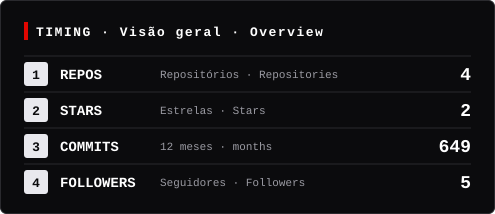
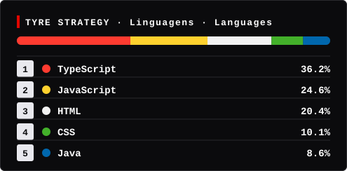

Generated daily by GitHub Actions from public repositories. The commit count only includes public contributions.

## 📻 Team Radio - Contact

- 💼 [LinkedIn](https://www.linkedin.com/in/jo%C3%A3o-v%C3%ADtor-de-alencar-fraissat-mamede-a59394270/)
- 📄 [Lattes CV](http://lattes.cnpq.br/2934832325743292)
