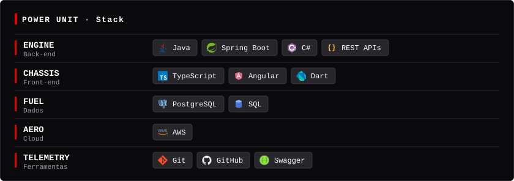
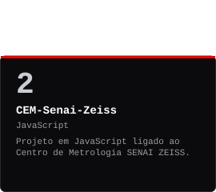
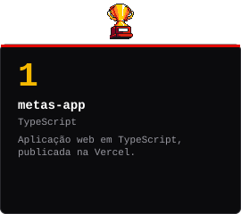
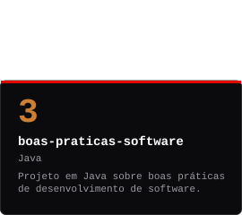
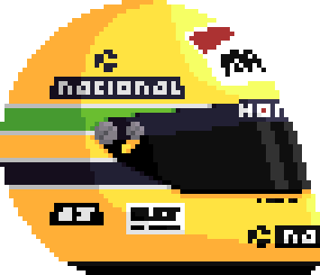
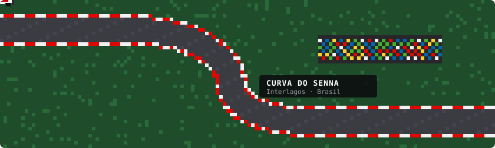

🇧🇷 Português · [🇬🇧 English](README.en.md)

## 🏁 Driver Profile - Sobre mim

Cursando o 8º período de Engenharia de Software na **Faculdade SENAI Fatesg** (desde 2023), com foco em aplicações web, liderança em projetos acadêmicos e desenvolvimento full stack. Estagiei na matriz da **ZEISS**, em Oberkochen (Alemanha), e atuo com metrologia, transformação digital e inovação tecnológica.

- 🎓 Engenharia de Software, Faculdade SENAI Fatesg
- 🌍 Estágio internacional na ZEISS IQS, Alemanha
- 🗣️ Português · Inglês (fluente, certificação ECCE) · Alemão (intermediário)
- 📜 AWS Academy Cloud Foundations · Curso de Metrologia (INMETRO)
- 📍 Goiânia, Brasil

## 🛞 Stints - Experiência

  

## ⚙️ Power Unit - Stack

  

##  Podium - Projetos em destaque

<table align="center">
  <tr valign="bottom">
    <td></td>
    <td></td>
    <td></td>
  </tr>
</table>

▶ <a href="https://metas-app-flax.vercel.app">metas-app: ver demo</a>

## 🏎️ Pit Lane - Garagem

  
  

🔴 Ferrari · era Schumacher &nbsp;·&nbsp; ⚪🔴 McLaren · Senna (1990–1993)

  
  &nbsp;&nbsp;
  

Capacete em pixel art, inspirado no de Senna ·  Mônaco: seis vitórias de Ayrton Senna, recorde do GP

<table align="center">
  <tr>
    <td align="center"> 🇧🇷 Interlagos</td>
    <td align="center"> 🇮🇹 Monza</td>
    <td align="center"> 🇯🇵 Suzuka</td>
    <td align="center"> 🇲🇨 Mônaco</td>
  </tr>
</table>

  

Carros, capacete, troféu e animação em pixel art; as pistas são ilustrações estilizadas, e os contornos delas são aproximações.

## ⏱️ Telemetry - Estatísticas

Gerado diariamente por GitHub Actions a partir de repositórios públicos. A contagem de commits considera apenas contribuições públicas.

## 📻 Team Radio - Contato

- 💼 [LinkedIn](https://www.linkedin.com/in/jo%C3%A3o-v%C3%ADtor-de-alencar-fraissat-mamede-a59394270/)
- 📄 [Currículo Lattes](http://lattes.cnpq.br/2934832325743292)
